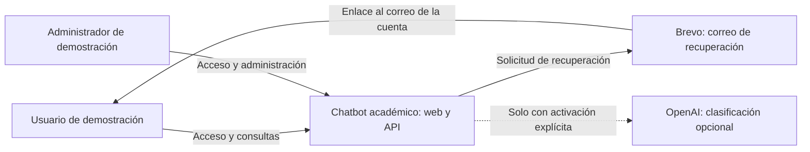
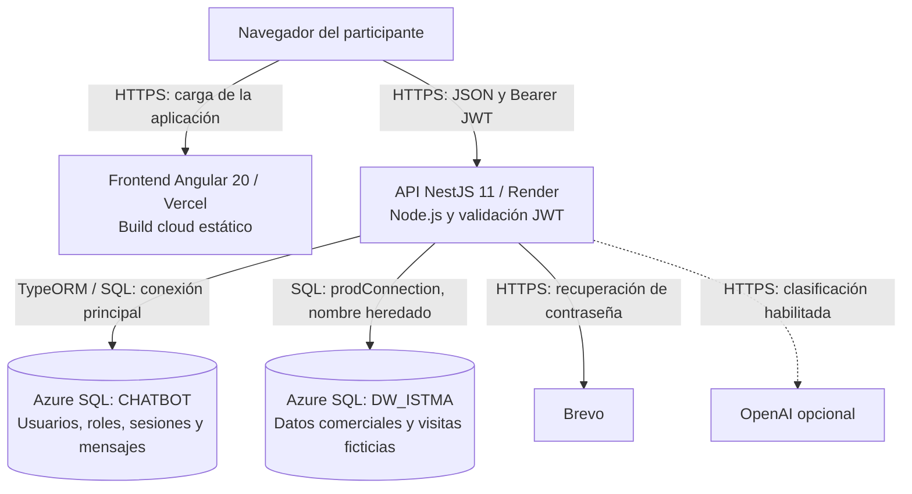

# Arquitectura del chatbot académico

Revisión: 21 de noviembre de 2026. Esta guía describe el código de la versión universitaria. Usa datos ficticios y tiene dos repositorios: [Frontend-Chatbot](https://github.com/AllanFl0r3s/Frontend-Chatbot) y [ChatbotBackendLocal](https://github.com/AllanFl0r3s/ChatbotBackendLocal).

## Contexto

Una persona inicia sesión y consulta información comercial o registros de visitas. Una cuenta administradora también puede gestionar usuarios. El navegador habla con la API; no se conecta directamente a SQL.



La integración de OpenAI es opcional. Los recorridos guiados del menú y la consulta de visitas no necesitan una llamada al modelo. El envío de recuperación sí requiere la configuración privada de Brevo. Los servidores de la empresa no forman parte de esta demostración.

## Contenedores y conexiones

Aquí, contenedor significa una parte ejecutable o un almacén de datos; no implica que el proyecto use Docker.



El build `cloud` publica archivos estáticos; el código SSR presente en el repositorio no es el servidor usado en Vercel para esta configuración. `PUBLIC_API_URL` aporta únicamente el origen HTTPS de la API. Las claves de SQL, firma de JWT, correo y OpenAI pertenecen al backend.

Las dos conexiones se declaran en `src/app.module.ts` del backend. `prodConnection` conserva su nombre original, pero en esta versión apunta a la base académica DW_ISTMA. TypeORM usa `synchronize: false`: los scripts SQL preparan el esquema y las semillas; iniciar la aplicación no crea las tablas.

En desarrollo, Angular usa el backend local configurado en `src/environments/environment.ts`. El entorno documentado del backend académico escucha en 3021 y SQL Express en 14330. La configuración local y la publicada son independientes; sus catálogos no tienen exactamente los mismos nombres de productos.

## Capas del código

| Capa | Frontend | Backend | Responsabilidad |
|---|---|---|---|
| Presentación y entrada | Componentes de auth, chat, visits y users | Controllers y DTO | Mostrar datos, recibir entradas y validar el contrato HTTP. |
| Aplicación | Servicios HTTP, AuthService, guards e interceptor | AuthService, ChatService, VisitsService y servicios comerciales | Coordinar el recorrido y aplicar permisos/reglas. |
| Reglas separadas | Estado de filtros y navegación | visits.core.ts y helpers | Validar filtros, seleccionar consultas permitidas y construir respuestas. |
| Persistencia e integraciones | HttpClient hacia la API | Repositorios TypeORM, consultas parametrizadas, correo y OpenAI | Leer o guardar datos y comunicarse con servicios externos. |

La separación es por módulos de NestJS y pantallas de Angular. No todas las reglas están aisladas: `ChatService` todavía reúne navegación y coordinación de consultas. `visits.core.ts` sí puede probarse sin iniciar NestJS ni conectarse a SQL.

## Carpetas principales

```text
Frontend-Chatbot/
  src/app/auth/         Acceso, registro y recuperación
  src/app/core/         Sesión, guards e interceptor HTTP
  src/app/chat/         Interfaz y cliente del chat
  src/app/visits/       Filtros, resultados y cliente HTTP de visitas
  src/app/users/        Administración de usuarios
  src/environments/    Configuración local y de compilación
  scripts/             Generación del entorno cloud
  test/                Pruebas de configuración y sesión en Node
  database/            Migraciones, semillas y verificadores académicos
  docs/                Entregas, decisiones y evidencia

ChatbotBackendLocal/
  src/auth/            JWT, sesiones y recuperación
  src/users/           Usuarios y permisos
  src/roles/           Roles
  src/chat/            Menú, consultas y entidades de conversación
  src/visits/          Controller, servicio y reglas de visitas
  src/perfil/          Perfil institucional
  src/deployment.config.ts  Validación de configuración pública
  database/            Preparación local, Azure y menú académico
  test/                Pruebas adicionales e integración HTTP
```

## Un recorrido de extremo a extremo

En visitas, `VisitsComponent` conserva los filtros enviados y pide una página a `VisitsApiService`. El interceptor adjunta el JWT solo a la API configurada. El backend valida la cuenta y su sesión, comprueba la ruta asignada, consulta DW_ISTMA con parámetros y devuelve totales y clientes. La pantalla distingue una consulta vacía de una falla y retira los resultados anteriores al comenzar otra consulta.

Los guards de Angular ayudan a navegar; la autorización efectiva está en el backend. Un administrador también necesita una ruta asignada para consultar visitas. CORS permite el origen web previsto, pero no sustituye el JWT ni los permisos.

## Estado y límites

Las compilaciones y pruebas repetidas el 21/11 se registran en la [bitácora de semana 6](bitacora/semana-6.md). El diagrama representa la configuración del proyecto; no certifica por sí solo que cada función esté publicada y operativa. Falta repetir el recorrido autenticado de visitas en producción y hacer pruebas con personas.

Las decisiones están en [docs/decisiones](decisiones/). El [segundo flujo propuesto](segundo-flujo.md) contiene los pasos para demostrarlo y registrar su evidencia.
