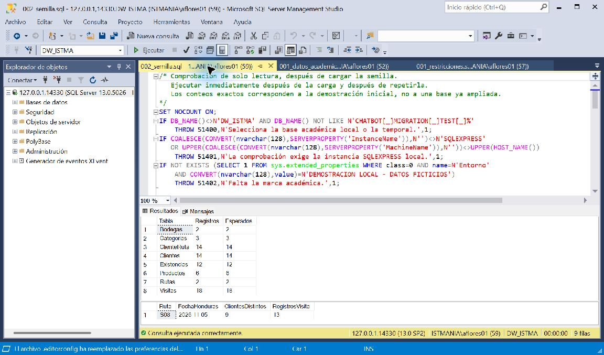
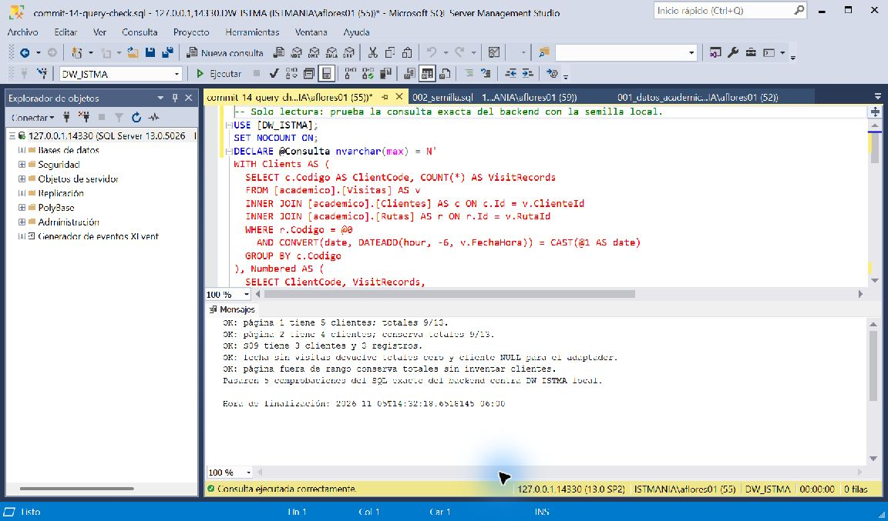

# Bitácora — Semana 3: datos y consulta local

Fecha de actualización: 5 de noviembre de 2026.

Durante esta semana preparé la base académica para trabajar con datos ficticios propios y conecté una consulta de visitas desde la aplicación. El objetivo fue completar un recorrido pequeño: iniciar sesión, elegir ruta y fecha, consultar el backend y ver los resultados de SQL Server.

## Qué se hizo

- Documenté el modelo actual y el diseño completo previsto, con diagramas Mermaid, claves, restricciones y reglas de borrado en [modelo-datos.md](../modelo-datos.md).
- Agregué una [migración versionada](../../database/migrations/001_crear_esquema_comercial.sql) que crea ocho tablas comerciales en el esquema academico de DW_ISTMA local. Usa transacción, registro de versión y bloqueo para evitar creaciones parciales o simultáneas.
- Separé los [datos semilla](../../database/seeds/001_datos_academicos.sql) de la migración. La carga registra su ejecución y repetirla no duplica ni sobrescribe filas.
- Conservé las tablas anteriores y las bases locales CHATBOT y DW_ISTMA. No se modificaron servidores empresariales ni se copiaron clientes reales.
- Agregué la pantalla Visitas, accesible desde el chat y la administración, con ruta, fecha, tamaño de página, resultados y errores claros.
- Incorporé el cambio del backend académico para consultar academico.Visitas, Clientes y Rutas. Conserva el JWT, la asignación de rutas en el servidor y el contrato de respuesta del endpoint.

## Tablas y datos de la demostración

| Tabla academico.* | Registros iniciales | Para qué sirve |
|---|---:|---|
| Clientes | 14 | Identificar comercios ficticios. |
| Rutas | 2 | Separar S08 de S09. |
| ClienteRuta | 14 | Relacionar clientes y rutas por período. |
| Visitas | 18 | Consultar registros por cliente, ruta y fecha. |
| Categorias | 3 | Clasificar productos. |
| Productos | 6 | Tener un catálogo ficticio con precios ilustrativos. |
| Bodegas | 2 | Distinguir existencias por ubicación. |
| Existencias | 12 | Preparar consultas de stock normal, bajo y agotado. |

La fecha de referencia de la semilla es fija: **2026-11-05 en Honduras**. Las visitas se guardan en UTC y el backend convierte al día local antes de filtrar. Así la demostración se puede repetir sin depender de la fecha actual.

Estas ocho tablas son de negocio. Las tablas de registro de migraciones y semillas son infraestructura y no se cuentan entre ellas. Las demás tablas del diseño completo siguen pendientes de implementación según las historias priorizadas.

## Pruebas y resultados

| Comprobación | Resultado y alcance |
|---|---|
| Migración en base temporal | Creación correcta; segunda ejecución reconoció la versión existente. |
| Restricciones SQL | Pasaron 8 casos: duplicados, vacíos, FK, fechas, precios/stock negativos, borrado protegido y visitas repetidas válidas. |
| Semilla en base temporal y DW_ISTMA local | Ejecutada dos veces en cada base; los conteos se conservaron. |
| Compilación | Backend Nest y frontend Angular de desarrollo/SSR correctos. |
| Reglas y servicio | Pasaron 10 pruebas de reglas/paginación y 7 del servicio académico. |
| SQL del adaptador en SSMS | Pasaron cinco comprobaciones: páginas de 5 y 4 clientes, separación S09, fecha vacía y página fuera de rango. |
| Cambio de día | Se comprobaron los límites 05:59/06:00 UTC en la base temporal; se revirtieron sus cuatro registros de prueba. |
| Prueba manual de la aplicación | El autor confirmó inicio de sesión, acceso a Visitas y resultados visibles después de incorporar ambos cambios y reiniciar las aplicaciones. |

Para **S08, 2026-11-05**, la referencia comprobada es **9 clientes distintos y 13 registros**. Con tamaño 5 hay dos páginas, de 5 y 4 clientes. S09 tiene 3 clientes y 3 registros para esa fecha. Un registro de visita no acredita una venta ni una visita completada.

La confirmación manual de la aplicación se registró en el chat de trabajo. Las capturas siguientes corresponden a SQL Server, no a una prueba automatizada del navegador.

### Límite de las pruebas automáticas

Las cinco pruebas HTTP existentes no pudieron completarse desde la terminal restringida porque denegó las conexiones locales con EACCES. El intento TypeORM directo desde esa terminal también quedó bloqueado con ESOCKET. La comprobación manual posterior confirmó el recorrido local de la aplicación, pero no convierte esa suite automática en aprobada. Queda repetirla desde una terminal con acceso normal.

## Cómo ejecutar y comprobar

Las bases locales ya están preparadas. No es necesario volver a crearlas ni recargar la semilla para probar este avance.

1. En la carpeta del backend académico, ejecutar `npm run start:dev`. Debe escuchar en el puerto 3021 con sus conexiones a SQL Server local.
2. En la carpeta Frontend-Chatbot, donde está package.json, ejecutar `npm start`.
3. Abrir [la aplicación local](http://localhost:4200), iniciar sesión con la cuenta de demostración y pulsar **Visitas**.
4. Elegir S08, 2026-11-05 y tamaño 5. Pulsar Consultar y comparar los resultados con la referencia 9/13.
5. Revisar Siguiente para la segunda página. También se puede probar S09 o una fecha sin registros.

La guía detallada del flujo y sus permisos está en [flujo-visitas.md](../flujo-visitas.md). La preparación de la base y sus scripts está en [database/README.md](../../database/README.md). No se publican archivos .env ni secretos reales; la cuenta de demostración se documenta en el backend académico.

## Estado de la entrega

| Requisito de semana 3 | Estado |
|---|---|
| Modelo Mermaid y diccionario | Documentados; se distingue lo implementado de lo propuesto. |
| Al menos 8 tablas comerciales con migraciones | Implementadas y comprobadas en SQL local. |
| Script semilla realista para desarrollo | Implementado y comprobado con datos ficticios. |
| Flujo central contra la base | Confirmado localmente. **Pendiente en producción pública por HTTPS.** |
| Bitácora semana-3 | Este documento. |
| Release o etiqueta semana-3 | Pendiente. No se creó ni publicó en este avance. |
| Mínimo de 15 commits y 3 recientes | Este cambio lleva el historial del frontend a 15 al incorporarlo. Después hay que subirlo con Push origin para que sea visible al evaluador. |
| Token académico en README | Se conserva el README existente, sin cambiar su token. |

La URL [de Vercel](https://chatbot-clase-vista-previa.vercel.app/login) sigue siendo una vista previa de la interfaz, con login deshabilitado. No se presenta como un despliegue conectado a SQL Server. El localhost de esta computadora no es una base accesible para un backend público.

## Qué aprendí y qué sigue

Completar una consulta pequeña ayudó a detectar diferencias entre clientes y registros, conservar los permisos y comprobar la conversión de fechas. También quedó claro que crear tablas o alcanzar una cantidad de commits no significa que la entrega completa ya funcione en internet.

El siguiente paso es preparar el alojamiento del backend y una base académica accesible para él, configurar las variables privadas, conectar el frontend por HTTPS y repetir el flujo en el dominio público. Después se revisará la lista completa de requisitos y se preparará el release semana-3 con el estado real de la entrega.
