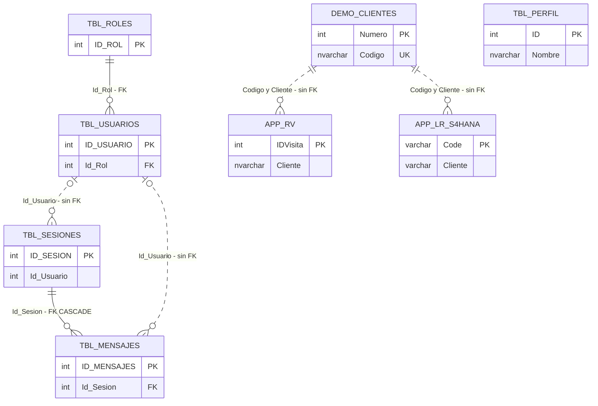
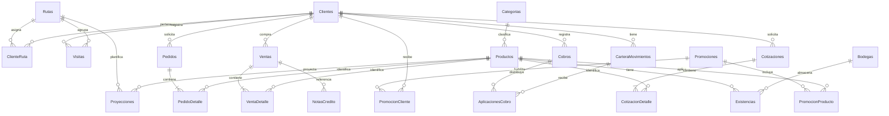

# Modelo de datos — Chatbot académico

## 1. Alcance y estado

Este documento diferencia **lo creado en SQL local** del **diseño propuesto del producto completo**. Un diagrama no significa que sus tablas o funciones ya estén implementadas.

El producto permite consultar información comercial mediante el chatbot y administrar su acceso. La versión académica usa datos ficticios propios. No modifica las bases de la empresa ni necesita copiar sus registros.

| Estado | Contenido |
|---|---|
| Creado por los scripts locales del backend | 5 tablas en CHATBOT y 3 fuentes heredadas en DW_ISTMA. |
| Probado localmente | Login y consulta heredada de visitas; migración y semilla de las 8 tablas academico, verificadas desde SSMS. |
| Publicado en Vercel | Vista previa de la interfaz, con login deshabilitado. No es aún el flujo central conectado a una base pública. |
| Propuesto en este documento | Modelo comercial completo, relaciones y restricciones pendientes de migraciones e integración. |

**La entrega de semana 3 sigue pendiente:** las 8 tablas originales no son 8 tablas de negocio; incluyen infraestructura de usuarios y chat. Ahora está preparada la migración versionada 001 con ocho tablas comerciales, separada de los datos semilla. Se aplicó en DW_ISTMA local después de probarla en una base temporal; pasaron sus ocho casos de restricciones. La semilla separada también se cargó y verificó sin duplicados. Los scripts originales crean bases nuevas y se detienen si ya existen: no deben ejecutarse otra vez para actualizar una base.

Fuentes revisadas: `database/local/01_crear_CHATBOT_local.sql`, `database/local/02_crear_DW_ISTMA_local_visitas.sql`, entidades y README del repositorio hermano `ChatbotBackendLocal`. Los nombres y restricciones empresariales que no conocemos no se dan por confirmados.

## 2. Cómo leer el modelo

- **PK:** identifica una fila; no se repite ni acepta NULL.
- **FK:** referencia una fila de otra tabla y evita registros huérfanos.
- **UQ:** valor o combinación que no puede repetirse.
- **NULL:** dato opcional; los demás campos indicados son obligatorios.
- **NO ACTION:** SQL impide borrar un registro si otro lo referencia.
- **CASCADE:** borrar el padre también borra sus hijos; actualmente se usa solo en mensajes de una sesión.

SQL Server no permite FK entre bases diferentes. Las relaciones entre CHATBOT y DW_ISTMA se validarán desde el backend, sin presentarlas como restricciones físicas existentes.

## 3. Modelo físico inicial de las fuentes heredadas

Los nombres del diagrama omiten los prefijos de base y esquema por legibilidad. Las líneas discontinuas representan vínculos lógicos sin FK física.

### 3.1 Diccionario: CHATBOT.dbo

| Tabla | Columnas actuales | Restricciones y comportamiento al borrar |
|---|---|---|
| TBL_ROLES | ID_ROL int IDENTITY PK; Nombre nvarchar(100); Descripcion nvarchar(255) NULL; Estado_Rol bit DEFAULT 1; Fecha_Creacion datetime2 DEFAULT SYSDATETIME() | Id_Rol en usuarios tiene FK con NO ACTION. No se borra un rol que tenga usuarios. Nombre no tiene UQ actualmente. |
| TBL_USUARIOS | ID_USUARIO int IDENTITY PK; Id_Rol int FK; Nombre nvarchar(150); Usuario nvarchar(100) NULL; Email nvarchar(150); PasswordHash nvarchar(255); Telefono_numero nvarchar(20) NULL; Fecha_Registro datetime2 DEFAULT SYSDATETIME(); Ultimo_Contacto datetime2 NULL; Estado bit DEFAULT 1 | Email UQ; Usuario tiene índice UQ filtrado WHERE Usuario IS NOT NULL. No hay FK física desde sesiones/mensajes al usuario: actualmente borrarlo puede dejar referencias huérfanas. Usar desactivación mediante Estado y corregir integridad en una migración posterior. |
| TBL_SESIONES | ID_SESION int IDENTITY PK; Id_Usuario int NULL; Fecha_Inicio y Ultima_Actividad datetime2 DEFAULT SYSDATETIME(); Contexto nvarchar(max) NULL; Canal nvarchar(20); CanalRef nvarchar(100) | Índice (Id_Usuario, Canal, ID_SESION DESC). Borrar una sesión elimina sus mensajes por CASCADE. Contexto es texto sin CHECK de JSON actualmente. |
| TBL_MENSAJES | ID_MENSAJES int IDENTITY PK; Id_Sesion int FK; Id_Usuario int NULL; Remitente nvarchar(30); Tipo_Mensaje nvarchar(30); Contenido nvarchar(max) NULL; Fecha_Hora datetime2 DEFAULT SYSDATETIME() | Índice (Id_Sesion, ID_MENSAJES). Requiere sesión existente. Borrar un mensaje no borra su sesión. No hay CHECK de remitente ni tipo actualmente. |
| TBL_PERFIL | ID int IDENTITY PK; Nombre nvarchar(150); Telefono y WhatsApp nvarchar(50) NULL; Correo nvarchar(150) NULL; Direccion1 y Direccion2 nvarchar(250) NULL; Horario nvarchar(150) NULL; Imagen nvarchar(500) NULL; Fecha_Modificacion datetime2 DEFAULT SYSDATETIME() | Sin FK. El servicio espera el ID 1; SQL no exige una única fila. No borrar esa fila desde la aplicación. |

PasswordHash almacena bcrypt, nunca la contraseña en texto. No se devuelve al frontend. Las claves de servicios y los secretos JWT se configuran fuera de las tablas y no se publican en Git.

### 3.2 Diccionario: DW_ISTMA local

| Tabla | Columnas actuales | Restricciones y comportamiento al borrar |
|---|---|---|
| demo.Clientes | Numero int PK; Codigo nvarchar(20) UQ; Nombre nvarchar(150); Ruta nvarchar(20) | Tabla auxiliar académica. Sin FK hacia ruta ni desde visitas/programación. Borrarla no elimina registros de esas tablas; puede dejar códigos sin cliente. |
| paco.APP_LR_S4HANA | Code varchar(50) PK; Ruta y Cliente varchar(20); Semana varchar(10) NULL; Dias y Orden int NULL; CodigoAnterior varchar(30) NULL | Sin FK ni CHECK. No se interpreta Dias/Semana como calendario empresarial confirmado. Borrar una programación no borra visitas. |
| paco.APP_RV | IDVisita int IDENTITY PK; ID int NULL; Ruta nvarchar(20); Cliente nvarchar(20); Fecha nvarchar(50); Liquidacion nvarchar(50) NULL; CodigoRevision nvarchar(20) NULL; EnRuta nvarchar(1) NULL; Hora nvarchar(10) NULL; Latitud y Longitud nvarchar(50) NULL; Semana nvarchar(10) NULL; Comentario nvarchar(500) NULL; IDListaVisita_IDListaVisita int NULL | Índice (Ruta, Cliente). Sin FK ni validación SQL de fecha/hora. Borrar un registro reduce el conteo; no borra al cliente ni su programación. |

`Fecha` y `Hora` son texto por compatibilidad con la consulta heredada. El endpoint convierte Fecha mediante TRY_CAST, filtra ruta/fecha y agrupa por código de cliente. Dos registros del mismo cliente no equivalen necesariamente a dos visitas completadas. `CodigoRevision` y `EnRuta` no demuestran una venta.

## 4. Diseño objetivo del producto completo — pendiente

**Avance de migraciones:** `database/migrations/001_crear_esquema_comercial.sql` crea las primeras ocho tablas de este diseño. Está aplicada en DW_ISTMA local y cargada con la semilla 001, comprobada en la base temporal y en la de desarrollo. Consulta [la guía de ejecución](../database/README.md). El resto de las tablas y la integración con los endpoints permanecen pendientes.

Se conservan las 5 tablas internas de CHATBOT. En DW_ISTMA se propone un esquema `academico` con 22 tablas comerciales propias. Los objetos `demo` y `paco` actuales siguen siendo fuentes de compatibilidad; no se renombrarán ni eliminarán automáticamente.

Este diseño cubre inventario, pedidos, ventas, proyecciones, promociones, visitas, cartera, cotizaciones y cobros. El chatbot **consulta** estos datos; no se propone que contabilice operaciones empresariales. Los scripts semilla crearán operaciones ficticias para probar las consultas.

La migración al diseño objetivo necesitará adaptar los servicios o crear vistas compatibles. Crear estas tablas por sí solo no hace funcionar las consultas heredadas. No se activará synchronize para modificar el esquema automáticamente.

El mínimo de un detalle en pedido, venta o cotización es una regla del backend al confirmar el documento. Una FK sola no obliga a que el padre tenga hijos.

### 4.1 Diccionario objetivo: convenciones

En las tablas siguientes, `Id` es int IDENTITY PK, salvo las tablas puente con PK compuesta. Cada referencia `...Id` es int FK a `Id` de la tabla indicada por el diagrama. Los campos son NOT NULL salvo que digan NULL.

Las cantidades serán decimal(18,3); precios, saldos e importes decimal(18,2); fechas de documento date; fechas de eventos datetime2 en UTC; moneda char(3), inicialmente HNL. Los códigos son texto para conservar ceros iniciales.

Las restricciones de las primeras ocho tablas ya están en la migración 001. Las del resto son **propuestas** y necesitan futuras migraciones. Consulta el estado comprobado en [validacion-datos-locales.md](validacion-datos-locales.md).

| Tabla academico.* | Campos, claves y restricciones propuestas |
|---|---|
| Clientes | Id; Codigo nvarchar(20) UQ; Nombre nvarchar(150); Activo bit DEFAULT 1. Código y nombre no vacíos. |
| Rutas | Id; Codigo nvarchar(20) UQ; Nombre nvarchar(100); Activa bit DEFAULT 1. Código normalizado sin espacios laterales. |
| ClienteRuta | ClienteId + RutaId + Desde date: PK compuesta; Hasta date NULL. CHECK Hasta >= Desde cuando exista. El backend evita períodos superpuestos para la misma pareja; permite múltiples rutas si el negocio lo requiere. |
| Visitas | Id; ClienteId; RutaId; FechaHora datetime2; CodigoRevision nvarchar(20) NULL; EnRuta bit NULL; Comentario nvarchar(500) NULL. Índice (RutaId, FechaHora, ClienteId). No imponer UQ cliente/día: puede haber varios registros legítimos. |
| Categorias | Id; Nombre nvarchar(120) UQ; Activa bit DEFAULT 1. Nombre no vacío. |
| Productos | Id; CategoriaId; SKU nvarchar(50) UQ; Nombre nvarchar(200); Descripcion nvarchar(255) NULL; PrecioBase decimal(18,2) CHECK >= 0; Activo bit DEFAULT 1. |
| Bodegas | Id; Codigo nvarchar(20) UQ; Nombre nvarchar(150); Activa bit DEFAULT 1. |
| Existencias | Id; ProductoId; BodegaId; Cantidad decimal(18,3); Minimo decimal(18,3) DEFAULT 0; ActualizadoEn datetime2. UQ (ProductoId, BodegaId); CHECK Cantidad >= 0 y Minimo >= 0 en esta demostración. |
| Pedidos | Id; ClienteId; Numero nvarchar(30) UQ; Fecha date; Estado nvarchar(20); Moneda char(3). CHECK Estado IN ('BORRADOR','CONFIRMADO','CANCELADO'). |
| PedidoDetalle | Id; PedidoId; ProductoId; Linea int CHECK > 0; Cantidad decimal(18,3) CHECK > 0; PrecioUnitario decimal(18,2) CHECK >= 0. UQ (PedidoId, Linea). |
| Ventas | Id; ClienteId; Sociedad nvarchar(10); Numero nvarchar(30); Ejercicio smallint; Fecha date; Moneda char(3); Estado nvarchar(20). UQ (Sociedad, Ejercicio, Numero); CHECK Estado IN ('CONFIRMADA','ANULADA'). |
| VentaDetalle | Id; VentaId; ProductoId; Linea int CHECK > 0; Cantidad decimal(18,3) CHECK > 0; PrecioUnitario decimal(18,2) CHECK >= 0. UQ (VentaId, Linea). |
| Proyecciones | Id; RutaId; ProductoId; Periodo date; CantidadObjetivo decimal(18,3) CHECK >= 0. UQ (RutaId, ProductoId, Periodo); Periodo representa el primer día del mes (CHECK DAY(Periodo) = 1). |
| NotasCredito | Id; VentaId; Sociedad nvarchar(10); Numero nvarchar(30); Ejercicio smallint; Fecha date; Importe decimal(18,2) CHECK > 0; Motivo nvarchar(250). UQ (Sociedad, Ejercicio, Numero). Moneda y cliente proceden de la venta. |
| Promociones | Id; Codigo nvarchar(30) UQ; Nombre nvarchar(150); Desde y Hasta date; DescuentoPorcentaje decimal(5,2); Activa bit DEFAULT 1. CHECK Hasta >= Desde y descuento entre 0 y 100. |
| PromocionProducto | PromocionId + ProductoId: PK compuesta y ambas FK. Una fila por producto incluido en cada promoción. |
| PromocionCliente | PromocionId + ClienteId: PK compuesta y ambas FK. Promoción habilitada solo para clientes relacionados, productos relacionados y fechas vigentes; no interpretar ausencia como acceso general. |
| CarteraMovimientos | Id; ClienteId; Sociedad nvarchar(10); Ejercicio smallint; Documento nvarchar(30); Posicion nvarchar(10); ReferenciaFactura nvarchar(30) NULL; FechaVencimiento date NULL; Saldo decimal(18,2); Moneda char(3); FechaCorte date. UQ (Sociedad, Ejercicio, Documento, Posicion, FechaCorte). Saldo admite signos positivos y negativos; no deducir el tipo de movimiento solo por el signo. |
| Cotizaciones | Id; ClienteId; Numero nvarchar(30) UQ; Fecha y VenceEl date; Estado nvarchar(20); Moneda char(3). CHECK VenceEl >= Fecha; Estado IN ('BORRADOR','ENVIADA','ACEPTADA','VENCIDA','CANCELADA'). |
| CotizacionDetalle | Id; CotizacionId; ProductoId; Linea int CHECK > 0; Cantidad decimal(18,3) CHECK > 0; PrecioUnitario decimal(18,2) CHECK >= 0. UQ (CotizacionId, Linea). |
| Cobros | Id; ClienteId; Numero nvarchar(30) UQ; Fecha date; Importe decimal(18,2) CHECK > 0; Moneda char(3); Estado nvarchar(20). CHECK Estado IN ('REGISTRADO','ANULADO'). Son datos de demostración, no un registro de pagos empresariales. |
| AplicacionesCobro | CobroId + CarteraMovimientoId: PK compuesta y ambas FK; Importe decimal(18,2) CHECK > 0. Enlaza cobro y partida explícitamente, sin asumir que todo saldo negativo es un cobro. |

### 4.2 Reglas que necesitan lógica y transacciones

- Confirmar un documento requiere al menos una línea válida; guardar cabecera y detalles en una misma transacción.
- Calcular subtotales como cantidad por precio y redondear a dos decimales; total como suma de subtotales. No confiar en totales enviados por el navegador. Impuestos y descuentos adicionales quedan fuera de este primer cálculo académico.
- No mezclar importes de distintas monedas. Una nota de crédito pertenece al cliente y moneda de su venta.
- Aplicar un cobro solo a partidas del mismo cliente y moneda, de un mismo corte seleccionado; nunca sumar cortes históricos como si fueran deudas diferentes. La suma de aplicaciones no supera el cobro ni el saldo aplicable. Evitar doble aplicación mediante transacción y control de concurrencia.
- No restar otra vez un cobro de un saldo de cartera que ya lo incluye: las aplicaciones son trazabilidad de la demostración, no un segundo cálculo contable sobre el saldo importado.
- El acceso a visitas depende de las rutas autorizadas para el usuario autenticado. Actualmente la asignación está en VISITS_ROUTE_ACCESS del servidor; no existe aún una tabla de permisos por ruta. Su reemplazo por una tabla será una mejora posterior.
- No cambiar el contrato de los endpoints actuales al introducir el esquema nuevo. Mantener nombres de campos y validar equivalencia con datos ficticios.

### 4.3 Política de borrado del diseño objetivo

Todas las FK comerciales propuestas usarán **ON DELETE NO ACTION**. Así no se pierde una venta, visita o documento por borrar un cliente, ruta o producto.

| Tipo de información | Acción de la aplicación |
|---|---|
| Clientes, rutas, categorías, productos, bodegas y promociones | Desactivar; conservar las filas referenciadas. |
| Pedidos, ventas, cotizaciones y cobros confirmados | Cancelar/anular mediante estado; conservar historia. |
| Detalles de documentos | Editar o borrar únicamente si el documento admite edición; rechazar cambios sobre confirmados. |
| ClienteRuta, PromocionProducto y PromocionCliente | Quitar relaciones explícitamente solo si las reglas permiten el cambio. No borrar sus catálogos. |
| Cartera, notas de crédito y aplicaciones | Conservar para trazabilidad; las correcciones se diseñarán expresamente antes de habilitar escrituras. |

Para CHATBOT se conserva inicialmente el CASCADE sesión-mensajes ya existente. La interfaz no ofrecerá un borrado de sesiones persistidas hasta definir la política de conservación; limpiar el chat visible no equivale a borrarlas de SQL. Se propone agregar FK de usuario con NO ACTION en sesiones y mensajes, después de comprobar que no hay datos huérfanos. No se aplica ese cambio desde este documento.

## 5. Próximos pasos, en entregas pequeñas

1. **Completado:** modelo versionado, migración y datos ficticios de las primeras ocho tablas, comprobados en SQL local.
2. **Completado en SSMS:** registro dbo.__AcademicMigrations y repetición de la versión 001 comprobados en la base temporal. El ejecutor PowerShell sigue pendiente de prueba contra el motor.
3. **Completado:** migración 001 aplicada en DW_ISTMA para Clientes, Rutas, ClienteRuta, Visitas, Categorias, Productos, Bodegas y Existencias. La ampliación del resto del modelo sigue pendiente.
4. **Completado:** database/seeds/001_datos_academicos.sql, con fecha fija y registro transaccional de carga; database/tests/002_semilla.sql verifica los resultados después de repetirlo.
5. Conectar una consulta completa desde el frontend al backend y a las tablas académicas. Probar permisos, filtros, resultados vacíos y errores.
6. Preparar backend y base accesibles desde el despliegue público por HTTPS. La instancia SQL de una PC y la vista estática actual de Vercel no resuelven esta entrega.
7. Registrar resultados reales en docs/bitacora/semana-3.md; crear release semana-3 solo cuando corresponda al estado entregado.

Las nuevas migraciones académicas y su guía están en database/ de este mismo repositorio, para que el evaluador pueda revisarlas. Los scripts originales de instalación y el servicio de ejecución siguen en el backend hermano. La guía explica el requisito de la base local marcada y cómo preparar una base temporal de prueba. El script semilla está en database/seeds/ y su comprobación en database/tests/.

La exigencia es **15 commits en total**, con al menos 3 en los últimos 10 días. Cada commit debe representar trabajo comprobable. Mantener en README el token académico requerido, que es distinto de cualquier contraseña o clave de API.
