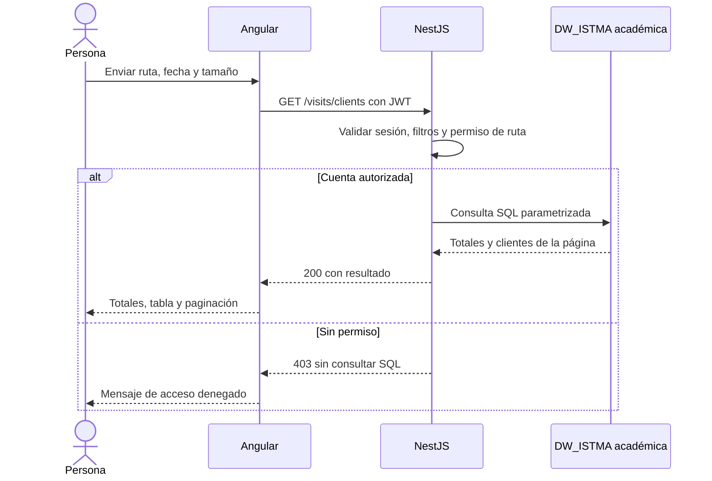

# Segundo flujo propuesto: consultar visitas por ruta y fecha

21 de noviembre de 2026. El recorrido ya existe en el código académico. Hoy se volvió a comprobar su API con SQL local real; no se implementó un flujo nuevo ni se verificó su interfaz en navegador.

**Estado de la entrega: pendiente.** La elección de este flujo es provisional. El propietario confirmó hoy que todavía no ha hecho pruebas con otras personas. No podemos atribuir esta selección a sus resultados ni afirmar que ya está validada en producción.

## Por qué proponerlo

El recorrido principal documentado para las pruebas incluye acceso, stock, detalle por bodega y salida. Visitas permite mostrar otro recorrido: filtrar una ruta y una fecha, leer clientes distintos y registros y pasar a otra página. Además, obliga a demostrar permisos por ruta.

La propuesta se basa en el código y en el guion T05 existente, no en hallazgos de participantes. Después de las sesiones habrá que confirmar esta prioridad o escoger otro flujo y registrar el motivo.

## Recorrido para la demostración

1. Abrir la aplicación e iniciar sesión con una cuenta académica.
2. Entrar a `/visits` desde el enlace Visitas.
3. Consultar S08, 05/11/2026, cinco clientes por página.
4. Comprobar nueve clientes distintos, trece registros y cinco clientes en la primera página.
5. Pulsar Siguiente: deben aparecer cuatro clientes y conservarse los totales.
6. Consultar una fecha sin registros: debe aparecer un resultado vacío, sin reutilizar el anterior.
7. Probar una ruta sin asignación: debe aparecer la denegación de acceso.
8. Cerrar sesión; las peticiones nuevas con la credencial anterior deben ser rechazadas.

Son registros de visita, no ventas ni garantía de visitas completadas. Los datos y la fecha son ficticios. Una cuenta administradora también necesita asignación de rutas en el backend.

## Verificación técnica del 21/11

Backend `e6ac25d`, `http://127.0.0.1:3021`, SQL local `127.0.0.1:14330`, bases CHATBOT y DW_ISTMA. Se inició temporalmente el backend compilado y se usó la cuenta académica local existente. No se crearon cuentas ni se escribieron operaciones comerciales. Login y logout sí registraron/cerraron una sesión de acceso. El proceso temporal se cerró al terminar.

| Caso HTTP real | Resultado observado |
|---|---|
| Petición sin JWT | 401. |
| Login de demostración | 201, credencial conservada solo en memoria. |
| S08, 2026-11-05, página 1, tamaño 5 | 200; nueve clientes, trece registros y cinco filas. |
| Misma consulta, página 2 | 200; cuatro filas y los mismos totales. |
| Página 3, fuera del resultado | 200; sin filas y total de nueve clientes. |
| S09, misma fecha | 200; tres clientes y tres registros. |
| S08, 2026-11-03 | 200; lista y totales vacíos. |
| Ruta ZZ999 sin asignación | 403. |
| Fecha imposible 2026-02-30 | 400. |
| Página cero | 400. |
| Logout de la sesión de prueba | 204. |
| Petición posterior con el JWT revocado | 401. |

Doce comprobaciones correctas. El [registro sin credenciales](evidencias/semana-6/verificacion-visitas-local.json) conserva los casos. Aparte pasaron 122 pruebas Jest del backend, diez pruebas de reglas de visitas en Node y catorce pruebas de configuración/sesión del frontend. Las pruebas automatizadas no equivalen a participantes.

## Repetir en producción

URLs previstas: [aplicación](https://chatbot-clase-vista-previa.vercel.app/login) y [salud de la API](https://chatbotbackendlocal-1.onrender.com/health).

El 21/11 la página de acceso respondió 200. La API pública no respondió dentro de los 45 segundos de espera, tanto en `/health` como en una petición anónima a visitas. Se registra como tiempo de espera agotado; no demuestra la causa ni un fallo permanente.

Antes de dar el requisito por terminado:

- Confirmar el despliegue y recuperar respuesta de la API pública; registrar el commit desplegado.
- Preparar una cuenta académica y su asignación S08/S09 en la configuración privada del backend.
- Repetir desde el navegador el recorrido completo en el dominio público; registrar fecha, resultado y evidencia sin credenciales.
- Realizar las sesiones del [guion de usuarios](pruebas-usuarios.md), anotar dificultades y justificar la selección final del segundo flujo.
- Enlazar la corrección o validación con su issue y PR reales.

No cambiar las tablas empresariales ni reutilizar credenciales del trabajo para preparar esta demostración.
